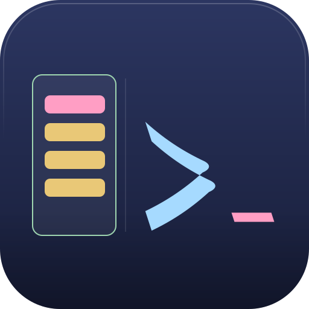
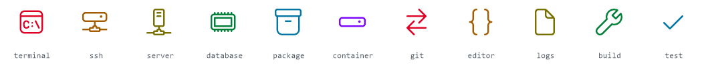
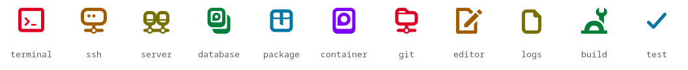

#  axan

A tree-of-shells terminal UI — a vertical sidebar tree of shells/agents under one window, instead of a tab bar. Built for the dev workflow where you want several shells open side-by-side, grouped into a tree you can see at a glance. In other words, I don't like tabs, I've never liked tabs. My hate for tabs is irrational and unreasonable and all-encompassing. For years have I toiled under the yoke of software designers who force tabs upon me against my will and I say, "No more shall your evil crush my spirit!"


## Architecture

axan is not a terminal emulator. It is a tree-of-shells UI that stands on the mature native terminal each OS already has — the only new thing it builds is the tree. On each platform axan embeds the most stable native terminal available and builds a thin native frontend that owns only the session tree (the launch-entry model, self-healing hierarchy repair, templated labels, the icon grammar, TOML interchange, and structured logging):

- **Linux** — a fork of gnome-terminal 3.52 hosting **VTE** (GTK3). VTE does the emulation; axan replaces the tabs with the session tree. The diff is concentrated in the sidebar widget (`terminal-sidebar.cc`), the Preferences Startup tab, the launch-entry machinery, and a couple of D-Bus additions (extra `CreateInstance` options plus a `CaptureWindowState` method) — the find bar, profile machinery, and accelerators are untouched gnome-terminal.
- **Windows** — a fork of **Windows Terminal** `v1.24.11321.0` (WinUI 2.8 / XAML Islands). Windows has no embeddable native terminal widget, so axan forks the whole app to obtain its `TermControl`, guts the tab strip, and hosts the control per tree node. WSL shells are ordinary nodes (`wsl.exe -d <distro>` over ConPTY).
- **macOS** — deferred, possibly permanently. A Mac reaches axan-on-Linux over SSH.

Both forks are **frozen, not tracked**: pinned to the vendored tag, with only security fixes cherry-picked and upstream feature churn deliberately ignored (pin details in [`windows/VENDOR`](./windows/VENDOR)).

Embedding the native widget means selection, IME, accessibility, scrollback, and rendering are inherited, never reimplemented — and the sidebar deliberately looks different per platform (GTK tree vs. WinUI `TreeView`).

## What's in this repo

| Dir | What it is | Substrate | License |
|---|---|---|---|
| [`linux/`](./linux) | The Linux frontend | gnome-terminal 3.52 + VTE fork, GTK3 | GPLv3 (root `COPYING`) |
| [`windows/`](./windows) | The Windows frontend | Windows Terminal fork (`v1.24.11321.0`), WinUI 2.8 | MIT (`windows/LICENSE`) |

Root `COPYING.GFDL` covers the GNOME-inherited help/man documentation under `linux/`.

## Building

Each frontend builds with its own toolchain on its own OS.

### Linux

meson + ninja against `linux/`. The dependency story is the same on every distro; only the package names differ:

| Dependency | Min version |
|---|---|
| vte-2.91 | 0.76.0 |
| gtk+-3.0 | 3.22.27 |
| libhandy-1 | 1.6.0 |
| glib-2.0 | 2.52.0 |
| libpcre2-8 | 10.00 |
| gsettings-desktop-schemas, libuuid, tomlplusplus, libX11 (X11 build only) | — |
| C++17 compiler, meson + ninja | — |

**Debian / Ubuntu** — VTE in apt is usually older than 0.76, so you will probably need to build VTE from source first (see the [VTE README](https://gitlab.gnome.org/GNOME/vte/-/blob/master/README.md)):

```sh
sudo apt-get build-dep libvte-2.91-0 gnome-terminal
sudo apt-get install g++ libtomlplusplus-dev
```

**Fedora** — validated against a fresh Fedora 44 install (June 2026). Fedora 42+ ships VTE 0.78+ in the main repo, so no source build of VTE is needed:

```sh
sudo dnf install \
    meson ninja-build gcc-c++ pkgconf-pkg-config itstool libxslt docbook-style-xsl \
    vte291-devel gtk3-devel libhandy-devel \
    glib2-devel gsettings-desktop-schemas-devel \
    pcre2-devel libuuid-devel libX11-devel \
    tomlplusplus-devel nautilus-devel \
    desktop-file-utils gettext
```

`nautilus-devel` provides `libnautilus-extension-4` for the file-manager integration, on by default — pass `-Dnautilus_extension=false` to `meson setup` to drop it (and omit `nautilus-devel`). `itstool` and `libxslt` are hard-required to build the AppStream metainfo and process the UI XML; `docbook-style-xsl` supplies the stylesheet the man-page build resolves via `--nonet`. All three are only needed for the default `docs=true` build — pass `-Ddocs=false` to skip the man page and yelp help entirely.

**Fedora on WSL** — axan runs under WSLg (no separate X server). Once before installing: enable systemd in `/etc/wsl.conf` (`[boot]` / `systemd=true`) so D-Bus user-session activation works, then `wsl --terminate <distro>` from Windows to pick it up. After that everything matches bare-metal Fedora.

**Build and run:**

```sh
cd linux
meson setup build --prefix="$HOME/.local"
ninja -C build
meson install -C build
axan
```

A non-root prefix like `~/.local` is the supported configuration. axan uses a D-Bus-activated server, so after reinstalling over a running instance the old server may still answer — kill `axan-server` and D-Bus will activate the newly installed binary. For build-without-install iteration, run the server directly under a scratch app id:

```sh
./build/src/axan-server --app-id test.Axan &
./build/src/axan --app-id test.Axan
```

**Debugging** — build with `-Ddbg=true`, then set `AXAN_DEBUG` (comma-separated flags, or `all`; values in `enum TerminalDebugFlags`, `linux/src/terminal-debug.hh`):

```sh
AXAN_DEBUG=selection,draw,cell axan-server
```

### Windows

Visual Studio 2022 / MSBuild against `windows/OpenConsole.sln` (present at the pinned tag; upstream later dropped it). Import `windows/.vsconfig` into the VS Installer for the exact component set. The repo root carries the working build scripts:

- `.build-release.ps1` — Release|x64 package build (signing via a machine-local cert; assets staged under `.release/`).
- `.deploy-cascadia.ps1 [-Rebuild] [-Launch]` — Debug|x64 dev build, deployed the way VS F5 does (`DeployAppRecipe.exe` over the loose AppX layout). You cannot run the loose `axan.exe` directly — packaged apps need identity, so build + deploy + launch is the loop. Pass `-Rebuild` after any preprocessor define change (e.g. branding), since MSBuild's timestamp check won't recompile for those.

Two toolchain notes are baked into the scripts: parallelism is capped (`CL_MPCount=8`, `/m:6`) because `TerminalSettingsModel`'s PCH exhausts memory on many-core machines, and clean rebuilds run Clean and Build as separate passes because a one-pass `/t:Rebuild` races the MIDL codegen.

## Configuration

The rule on every platform: **the native config store is canonical** — the running app reads only it. Linux reads GSettings/dconf; Windows reads Windows Terminal's `settings.json`. A portable **TOML mirror** carries settings between machines and platforms: importing writes into the native store, exporting reads from it. Omit a key in the TOML and the native value is left untouched.

### The launch-entry tree

The curated startup tree — which shells to spawn, in what hierarchy — is a list of **launch entries**. Every entry has the same fields on both platforms:

| Field | Meaning |
|---|---|
| `id` | stable minted UUID; reorder/reparent never break references |
| `parent-id` | parent entry's `id`; `""` = root; forward references only (a parent appears earlier in the list) |
| `name` | label template (see below); `""` = fallback chain (OSC title → directory basename → "shell") |
| `directory` | working directory; `~` = home; `""` = the directory axan launched from |
| `command` | raw command; `""` = the profile's login shell |
| `icon` | icon id (see the icon grammar below) |
| `color` | recolor token — `red orange yellow green blue purple` (theme-resolved) or literal `#RRGGBB`; sparse (omitted when empty) |
| `color-target` | `icon` \| `text` \| `both`; sparse (omitted when empty or `both`) |
| `kind` | `session` (default, omitted) or `separator` — a divider row in the sidebar tree that spawns nothing; it nests and orders like a session. Windows only for now (Linux support later) |
| `style` | separators only: `line` (default, omitted) draws a rule; `space` leaves an open gap |
| `height` | separators only: height in session-row units, tenths, `0.1`–`10`; sparse (omitted when `1.0`) |
| `placement` | separators only: `inline` (default, omitted) keeps its list position; `bottom` pins it below its siblings so sessions added later land above it |
| `name` (on a separator) | separators only: an optional section-header label; `""` (omitted) = a plain divider |
| `collapsed` | labelled separators only: `true` starts the section collapsed; sparse (omitted when `false`) |
| `hoist` | sessions only: whether the session joins the sidebar's hoisted group. Omitted = follow `sidebar.hoistStates`; `"never"`; or its own list of state names (`["running"]`). Windows only |

`command` is stored raw. The per-shell survival wrap that keeps a node alive after its command exits (Linux `$SHELL -c "…; exec $SHELL"`, pwsh `-NoExit -Command`, cmd `/k`, WSL `bash -ic "…; exec bash -i"`) is applied at spawn time, never stored, so the command ports across platforms. Malformed trees self-heal on load: orphans and dangling parents promote to root, missing UUIDs are backfilled. The tree is honored only when the CLI asks for no shells of its own — `--tab`, `--working-directory`, and positional commands take precedence.

**Separators in the sidebar (Windows):** add one with **Add separator** on the Startup sessions settings page, where its style, height and placement are edited; it appears in the sidebar at its place in the tree on the next launch, and deleting it there removes it from the sidebar when the settings save. Separator rows are **locked by default** — they take no click, focus or drag, so ordinary sidebar use can't disturb them. Hold **Ctrl+Alt** (both keys) to unlock every separator for the native drag-and-drop: drag one to reorder it or drop it onto a session to nest it under that session; releasing either key locks them again. AltGr on international layouts does not count as Ctrl+Alt. Right-clicking a separator shows the same menu as empty sidebar space. **Save current as startup** captures separators along with the sessions, in their current order.

**Section headers (Windows):** give a separator a **label** on the Startup sessions page and it becomes a section header: a muted label with a chevron. Clicking the header (or **Collapse section** in its right-click menu) hides the rows after it up to the next separator at the same depth, without moving anything in the tree. A collapsed header shows how many sessions it hides and the most urgent state among them (`Work · 5 · 1 needs you`); clicking that badge expands the section and selects the row. The session you're on stays visible even inside a collapsed section, and a row dropped into a collapsed section expands it. **Collapsed** on the settings page sets how a section starts; **Save current as startup** records each header's current state. Headers aren't keyboard-focusable (they stay out of the tab order like other separators), so there's no Left/Right toggle; use the click or the menu.

**Where the tree lives natively:**

- **Windows** — a single global `startupSessions` array on the root of WT's `settings.json` (camelCase keys: `id`, `parent`, `profile`, `name`, `directory`, `command`, `icon`, `color`, `colorTarget`). Each entry additionally carries `profile` — the GUID of the WT profile it spawns under (which shell: cmd/pwsh/WSL distro), empty = the default profile. One workstation tree, mixed shells, edited on the global **Startup sessions** settings page. WT's profiles keep owning appearance and the shell commandline; axan entries reference them.
- **Linux** — a per-profile `default-launch-entries` GSettings key (an `a(ssssssss)` tuple array). GNOME Terminal has one shell per profile, so there is no per-entry profile reference; entries run under the owning profile. The Preferences → Startup tab is the GUI editor; **⌖ Capture current window** snapshots the live sidebar tree (cwd + name + hierarchy, not commands) into the edited profile's entries, and **⌖ Capture as new profile…** does the same into a fresh profile cloned from the current one.

**The Startup sessions page (Windows)** is in the Settings **Sessions** group, next to the Sidebar page. The left side lists the rows in tree order (nesting, icon, colour and name; a separator shows as a header row), with **Add session**, **Add separator**, **Import from TOML…** and **Save current as startup** above it. The toolbar under the list acts on the selected row: Move up / Move down (among its siblings, with its children), Outdent, Indent, Duplicate and Delete. With the list focused, the same actions are Alt+Up / Alt+Down, Alt+Left / Alt+Right, Ctrl+D and Delete. You can also drag a row to a new place; its children move with it, and it never lands nested under a separator. The right side edits the selected row. A session has **Identity** (the same name, icon and colour editor as the sidebar's Edit node card, plus an **Icon as text** box for an emoji, a `builtin:NAME` token or an image path), **Launch** (profile, directory with Browse, command) and **Hoisted group** (see [what the row shows](docs/program-status-osc-7501.md#5-what-the-row-shows)). A separator has its label, **Start collapsed**, style, height and placement. On a narrow window the editor moves under the list.

### Session state in the sidebar

Windows only for now. Each sidebar row shows what its session is doing, so you can leave a long build or a coding agent alone and glance at the sidebar to see who needs you: a dot on the icon for a session waiting on you, finished or failed, a second line with the message and its age, and a glyph and short word at the right edge (`working`, `running`, `needs answer`, `idle`).

The state comes from three places. Programs report it themselves with **OSC 7501, the Program Status Protocol**, which Claude Code already speaks. A plain shell shows *running* while a command executes, from the OSC 133 marks axan's shell integration emits for PowerShell and WSL. And a bell in an idle tab marks it as done until you look at it.

The `sidebar.*` settings on the **Sidebar** page in the Settings **Sessions** group control idle dimming, the hoisted "Needs you" group, the glyphs and words, and the sizes. To test without an agent, run `tools/axan-status.sh` or `tools/axan-status.ps1` in a pane (`tools/axan-status.sh --demo`), or right-click a row and use **Preview state**.

**The full reference is [docs/program-status-osc-7501.md](docs/program-status-osc-7501.md)**: the escape sequence and what axan rejects, how each state looks in a row, when a report counts as seen, every setting, emitter examples for bash, PowerShell and cmd, and what to look for in the log.

### The portable TOML

To write a startup tree by hand, or have an agent write one, follow [docs/startup-sessions-toml.md](docs/startup-sessions-toml.md): every key, what Import does, and a validated example.

Every file starts with a version block:

```toml
[meta]
axan-toml-version = 1       # interchange schema version; newer versions are rejected
exported-by       = "windows"   # provenance, advisory only
```

A file is version `1` unless it contains a separator row, in which case it is version `2` — a tree without separators still round-trips through a reader that only knows version 1 (an older Windows build; the Linux build does not read this file yet, see the known gap below).

Keys axan designs are **kebab-case, always** (`parent-id`, `color-target`, `axan-toml-version`). Unknown keys are skipped with a logged warning, never an abort.

**The startup tree** exports as `startup-sessions.toml` (Windows writes it to the package `LocalState`; auto-exported on settings change, imported via the Startup sessions page):

```toml
[[startup-sessions]]
id           = "b1dcc9dd-5262-4d8d-a863-c897e6d979b9"
parent-id    = ""                 # "" = root
profile      = "61c54bbd-…"       # referenced profile GUID; omitted = default profile
profile-name = "PowerShell"       # cross-machine fallback: import matches GUID first, then name
name         = "$dir $branch"
directory    = "~"
command      = "claude"
icon         = "builtin:terminal"
color        = "blue"             # sparse
color-target = "icon"             # sparse
hoist        = ["blocked", "running"]  # sparse; or "never"; omitted = follow sidebar.hoistStates

[[startup-sessions]]              # a separator (Windows only for now); makes the file version 2
id           = "5f0c2a7e-…"
parent-id    = ""
kind         = "separator"
style        = "space"            # sparse; default "line"
height       = 0.5                # session-row units; sparse when 1.0
placement    = "bottom"           # sparse; default "inline"
name         = "Work"             # sparse; a labelled separator is a section header
collapsed    = true               # sparse; labelled separators only
```

**Whole profiles** export as per-profile `<uuid>.toml` mirrors with two layers: a portable core (`[profile]` — `uuid`, `name`, and the entry tree) that round-trips across platforms, and an opaque native passthrough (`[profile.native.linux]` / `[profile.native.windows]`) carrying each platform's remaining settings verbatim in their native casing (gschema kebab / WT camelCase). The importing platform applies the block matching its own OS and ignores the other — a Linux→Windows import drops Linux appearance scalars by design rather than mistranslating them.

Known gap: the Linux profile export is still a flat `[profile]` table of gschema keys — it does not yet emit the `[meta]` version block or nest its platform scalars under `[profile.native.linux]` as described above; the portable core (uuid, name, launch entries) uses the canonical keys and round-trips today.

### Label templates

An entry's `name` is a template, expanded at render time (same vocabulary on both platforms): `$pwd $cwd $dir $~ $user $host $hostname $shell $cmd $title $branch $repo` and `${file:path}` (first line of a file). `$branch`/`$repo` are computed by walking up from the shell's live cwd to `.git` — including WSL cwds via `\\wsl.localhost\…` paths. Unknown variables render literally. Live cwd tracking comes from shell integration axan injects at spawn (OSC 9;9 / OSC 7 emit for pwsh, cmd, and WSL bash). Variable names are case-insensitive and `-`/`_` are interchangeable; `$branch` and `${file:…}` refresh on the shell's next OSC event (the prompt redraw after a `cd` or `git checkout`), not in real time.

### Icons

For picking glyphs that Windows 11 can draw, with names, code points and TOML escapes, see [docs/startup-sessions-toml.md](docs/startup-sessions-toml.md#5-icons).

<picture>
  <source media="(prefers-color-scheme: dark)" srcset="assets/builtin-icons-dark.png">
  
</picture>
<picture>
  <source media="(prefers-color-scheme: dark)" srcset="assets/builtin-icons-linux-dark.png">
  
</picture>

*The `builtin:` vocabulary rendered natively twice — Segoe Fluent glyphs on Windows (top), GTK symbolic icons from the system theme on Linux (bottom), tinted with the six palette colors. The names are the portable part: a tree written on one OS draws in the other's native glyphs.*

The icon field's grammar:

- `""` — no icon; a default placeholder glyph.
- `builtin:NAME` — the portable vocabulary, rendered natively per platform (symbolic icons on Linux, Segoe Fluent glyphs on Windows). Eleven curated names, append-only: `terminal ssh server database package container git editor logs build test`.
- Native forms, carried verbatim and **not** portable: a file path or bare filename under `~/.config/axan/icons/` (Linux); a Segoe codepoint, emoji, or image/binary path (Windows). On import to the other platform an unrecognized native icon falls back to the placeholder with a logged warning — never mistranslated.

An entry with no icon of its own inherits one: node override → the profile's icon → a stable auto-assigned glyph (hashed from the profile, so it survives relaunch).

### Adding your own icons

**Linux** — drop `.svg` files into `~/.config/axan/icons/`, then run `axan --import-icons` (or the import button in Preferences). Each file is validated before it reaches the picker: the filename must match `name.svg` (lowercase ASCII, starts alphanumeric, dashes/underscores allowed), the file must be under 100 KiB, and it must actually render at sidebar size. Passing names are registered in `~/.config/axan/icons.toml`; the picker reads that registry, not the folder, so a failing file is reported with a reason and stays out of the dropdown. Reference a registered icon by its bare filename, or any image on disk by absolute path. The importer is SVG-only because vectors scale cleanly — but the resolver renders whatever gdk-pixbuf can load, so if you'd rather use a PNG, a WebP, or for some reason an animated GIF, drop it in the folder, set the entry's `icon` to the bare filename by hand, and it will render; it just won't appear in the picker, which is reserved for validated SVGs.

**Windows** — right-click a session node (or use the titlebar app menu) → **Edit node (label + icon)…**. The same editor is on the Startup sessions settings page for a startup entry. Search the whole Segoe Fluent Icons font (about 1,400 glyphs, by name) and pick one, switch the picker's character-set selector to **Letters and digits** for a-z, A-Z or 0-9, type a code point (`U+131A3`, `0x131A3` or `131A3`) into the search to pick any character the system's fonts can draw, or **Browse to icon file…** to use an image (PNG/ICO/SVG) or extract an icon from an exe/dll. A picked glyph is stored by its name, e.g. `"icon": "robot"`, and a letter, digit or code-point pick as the character itself, e.g. `"icon": "a"`; the eleven portable names (`terminal`, `git`, `server`…) work too and export to the TOML as `builtin:NAME`. The recolor swatches tint the glyph and/or the label text (the `color`/`color-target` fields). When hand-editing `settings.json` or the TOML instead, the `icon` string also accepts a glyph name, a Segoe Fluent/MDL2 glyph character, an emoji, or any other single character (a letter, a digit, a hieroglyph) directly. Characters whose fallback font draws them small (Egyptian hieroglyphs and runes, from Segoe UI Historic) are scaled up to match emoji and Segoe Fluent glyphs; the per-font factors are in `windows/src/inc/AxanGlyphScale.h`. Overrides persist per node and survive relaunch.

### Sidebar and backdrop transparency (Windows)

By default the sidebar and the surface behind the terminal panes are opaque, so a profile with reduced opacity or acrylic composites over a solid app-colored backdrop rather than the live desktop. The easy path is the **Sidebar matches profile transparency** toggle on the Settings > Sidebar page (the `sidebarMatchesProfileTransparency` global in `settings.json`): it paints the sidebar with the focused profile's background and opacity and leaves the backdrop behind the terminal clear, so the whole window shares one transparency. Set the opacity per profile under the profile's Appearance > Transparency (`"opacity"` below 100, 80 pairs well, or `"useAcrylic"`). While the toggle is on it overrides the theme keys below.

The manual path is a theme in `settings.json` with two axan-only keys, `sidebar.background` and `content.background`, which take the same values as Windows Terminal's `tabRow.background`: `"#RRGGBB"`, `"#RRGGBBAA"`, `"accent"`, or `"terminalBackground"`. `"terminalBackground"` follows the focused profile's background, opacity included, and is the recommended sidebar value; `"#000000CC"` (80% black) is the fixed-tint alternative, which keeps sidebar labels readable over a busy desktop regardless of the profile; `"#00000080"` is a half-transparent scrim; `"#00000000"` is fully see-through. Leave a key unset and that surface keeps today's opaque look. The content backdrop sits *behind* the terminal panes, so it only shows once a profile has reduced opacity or acrylic, and its alpha then stacks with the profile's: a 90% pane over a 90% black backdrop is nearly opaque. Let the profile opacity do the work and keep `content.background` fully clear. For example:

```json
"themes": [
    {
        "name": "glass",
        "sidebar": { "background": "terminalBackground" },
        "content": { "background": "#00000000" }
    }
],
"theme": "glass"
```

## Logging

Structured, file-only logs (RFC 5424-inspired: timestamp, level, component, a structured-data block of key/values, message). Linux writes `~/.cache/axan/axan.log`; Windows writes `%LOCALAPPDATA%\Packages\sh.axan.Axan_…\LocalState\logs\axan.log`. Nothing goes to stdout, and a logging failure is never allowed to take down the terminal.
